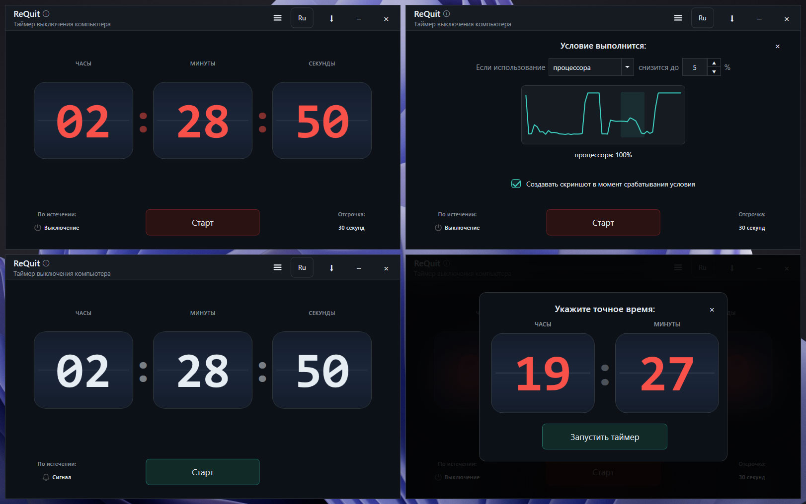

# ReQuit

ReQuit — приложение для **автовыключения ПК** с красивым таймером. Умеет срабатывать не только по таймеру, но и если нагрузка на процессор/видеокарту/интернет упадёт ниже заданного порога. Поставил рендер или скачивание чего либо - программа сама выключит ПК по завершении. Может работать как auto-shutdowner, а может как таймер с сигналом. Умеет сворачиваться в трей и показывать оставшееся время прямо на иконке.

## Запуск

**Скачать и запустить [ReQuit.exe](https://github.com/dinosmike/ReQuit/releases/tag/ReQuit_1_0) (версия 1.0)** 

## Скриншот программы

## Возможности

- **Таймер выключения**
  - Красивый безрамочный интерфейс с анимированными цифрами часы/минуты/секунды.
  - Заводить таймер можно кликами, перетаскиванием, скроллом или сбросить правой кнопкой мыши.
  - Выключение Windows происходит с принудительным закрытием приложений.
  - Для выключения можно настроить отсрочку: `нет / 30 сек / 1 мин / 5 мин`.
  - Во время отсрочки появляется **полноэкранное окно-предупреждение**:
  - Режим “Сигнал” вместо выключения воспроизводит аудио-оповещение.
  - Если таймер активен - при закрытии показывается подтверждение.

- **Монитор ресурсов (условие вместо таймера)**
  - Запуск действия **когда нагрузка падает ниже порога** (в процентах).
  - Варианты ресурса для установки порога: `Процессор, Видеокарта, Интернет`.
  - Защита от случайного срабатывания: условие должно выполняться **30 секунд**, прежде чем сработает.
  - Опция: **сохранить скриншот экрана** позволяет увидеть, что было на экране перед выключением.

- **Точное время**
  - Можно указать **точное время на часах**, и ReQuit сам рассчитает таймер до указанного времени.

- **Трей**
  - Сворачивание в трей по кнопке в заголовке.
  - Иконка в трее превращается в “таймер-цифры”, который показывает оставшееся время.

- **Локализация**
  - Встроенные языки: **Русский / English**.
  - Переключение из интерфейса, язык запоминается.

## Как пользоваться

### Обычный таймер

1. Выставьте `часы : минуты : секунды`.
2. Выберите действие **“Выключение”** или **“Сигнал”**.
3. В случае **Выключения** можно выбрать **отсрочку** перед выключением.
4. Нажмите **Старт**.

### Точное время и монитор ресурсов

- Открывается кнопкой **“Меню”** в заголовке окна, либо  правым кликом на фоне.

## Настройки и где они лежат

ReQuit хранит настройки в JSON-файле: %LocalAppData%\ReQuit\ReQuit_settings.json

## Технологии

- Windows 10/11
- **WPF (.NET 6, `net6.0-windows`)**
- NAudio (проигрывание встроенного MP3)
- Performance Counters / System.Management / DXGI (монитор ресурсов: CPU/GPU/сеть)